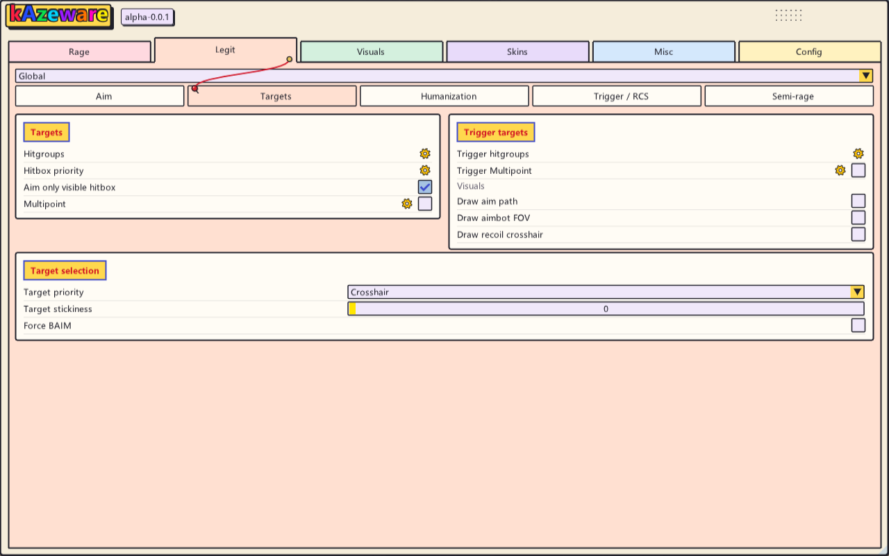
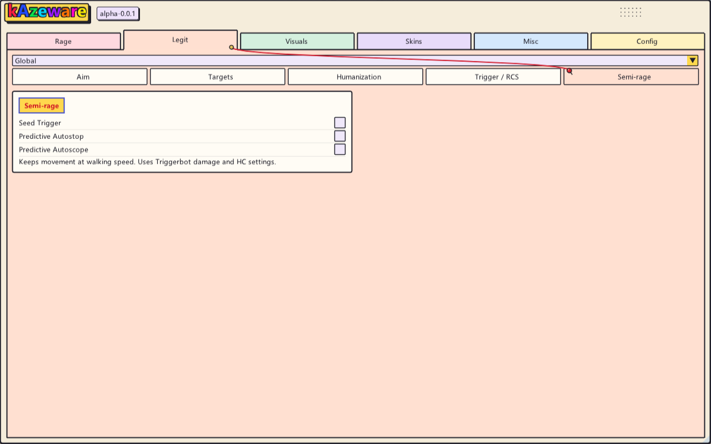

# kAzeware

**有全部功能的 CS2 HvH 菜单**

[下载版本](https://github.com/KaguraWang/kAzeware/releases) · [浏览源码](kAzeware/source) · [MIT License](LICENSE)


## 功能一览

| 页面 | 内容 |
| --- | --- |
| Rage | 目标选择、伤害与命中率、多点、穿墙、DT、急停 / 开镜与 Anti-Aim |
| Legit | FOV、平滑、目标部位、瞄准曲线、Triggerbot、RCS 与 Semi-rage |
| Visuals | 玩家 ESP、Chams、镜头与命中反馈、世界效果、投掷物轨迹和点位管理 |
| Skins | 枪械、刀、手套和人物模型浏览与配置 |
| Misc | 移动辅助、Peek、近战辅助、投掷控制与 HUD widgets |
| Config | 参数保存 / 加载、压缩、界面样式与翻译包 |

## Rage

左侧选择参数，中间调整 Accuracy，右侧集中管理 Rage Aimbot 和 Anti-Aim。Global、武器组、单把武器按层级组织；武器覆盖只保存 Accuracy，瞄准与 Anti-Aim 使用全局设置。

- Hitboxes 与 Multipoint 集中在 Accuracy；MP 齿轮内提供逐部位比例。
- MD、HC、MP 支持 Auto；自动 HC / MP 提供均衡、可靠性、时机三种策略。
- DT 仅用于 Rage 枪械开火，排除 R8，并通过 widget 展示充能状态。
- 射击外推与移动外推分别控制，配合伤害、命中率和穿墙路径判断。


## Legit

从 FOV 和平滑到目标部位、瞄准曲线、扳机与后坐力控制，按用途分成五个子页面。支持单独的武器参数及条件检查。


<details>
<summary>查看 Targets、Humanization、Trigger / RCS、Semi-rage</summary>

**Targets：目标部位、优先级与瞄准可视化。**



**Humanization：曲线、速度变化、反应延迟与微调。**


**Trigger / RCS：扳机条件、射击时序与后坐力控制。**


**Semi-rage：Seed Trigger、预测急停与预测开镜。**



</details>

## Visuals

本地、友方和敌方分别配置。玩家页面提供边框、血条、装备信息、状态标记、Glow 与多种 Chams 材质；本地页面集中镜头、模型和命中反馈。World 与 Nade Pred 分别管理环境效果和投掷物辅助。


<details>
<summary>查看 Local、Friendly、World、Nade Pred</summary>

**Local：模型、镜头、显示移除与命中反馈。**


**Friendly：独立的友方显示选项。**


**World：天空、光照、天气、道具与环境效果。**


**Nade Pred：轨迹、落点与投掷点位采集 / 管理。**


</details>

## Skins

通过图标网格浏览枪械、刀和手套，支持搜索与阵营区分；人物模型单独管理。皮肤配置包含磨损、模板和适用物品的 StatTrak 设置。


<details>
<summary>查看 Knives、Gloves、Agents</summary>

**Knives。**


**Gloves。**


**Agents：双方人物模型与自定义入口。**


</details>

## Misc

移动、近战、投掷控制和信息 widgets 集中管理。包含 Bhop、Autostrafe、Quick Peek、Duck Peek、刀 / 电击枪辅助，以及按键列表、炸弹信息和观战列表。Quick Peek 可选择是否仅等待同一目标的 DT 第二发。


## Config

保存和加载参数，管理压缩、DPI、圆角、默认页面及翻译包。多数功能可通过右键绑定快捷键，齿轮展开对应的细节设置。


## 使用与构建

- 发布包见 [Releases](https://github.com/KaguraWang/kAzeware/releases)。Windows x64 standalone DLL 静态链接 CRT，字体和命中音内嵌。
- `Insert` 开关菜单，`F4` 正常卸载。
- 参数与翻译位于 `Documents/kAzeware/Configs/`；投掷点位位于 `Documents/kAzeware/GrenadeHelpers/`。

<details>
<summary>源码结构与构建说明</summary>

项目采用 C++23、Direct3D 11 和 ImGui。

```text
kAzeware/source/     游戏 SDK、功能、菜单与配置
kAzeware/external/   第三方源码依赖
kAzeware/resources/  内嵌资源
loader/              可选加载器工程
translations/        翻译包
bin/x64/Release/     本地构建输出
```

本机验证环境为 Visual Studio Build Tools v145、Windows SDK 10.0.26100.0、DirectX SDK June 2010。工程沿用 DirectX SDK 默认安装目录，其他安装位置需对应调整。

在根目录 PowerShell 执行：

```powershell
$env:CL='/FS'
& 'C:/Program Files (x86)/Microsoft Visual Studio/18/BuildTools/MSBuild/Current/Bin/MSBuild.exe' kAzeware.sln /m:1 /t:Build /p:Configuration=Release /p:Platform=x64 /p:MultiProcessorCompilation=false /v:minimal /nologo
```

DLL 输出 `bin/x64/Release/kAzeware.dll`；解决方案另含可选加载器。第三方依赖保留各自许可证，上游授权见 [LICENSE](LICENSE)。

</details>

## 版本公告

### alpha-0.0.1 · 2026-11-12

[下载此版本](https://github.com/KaguraWang/kAzeware/releases/tag/alpha-0.0.1)

- Rage 改为 Config 侧栏 + Accuracy + 全局 Aimbot / Anti-Aim；支持搜索新增武器或组，手持武器置顶、右键确认移除。
- Hitboxes / Multipoint 移入 Accuracy；MP 齿轮常驻，保留逐部位比例；HC 齿轮仅 Auto 时显示。
- Quick Peek 增加“仅等待同目标 DT 第二发”的可选策略，默认沿用原等待行为；调整斜面 / 楼梯回撤的碰撞与速度处理。
- 菜单标志与 DLL 属性统一显示 `alpha-0.0.1`。
- 适配基于 CS2 1.41.9.7 / build 14197；游戏更新后需重新核对兼容性。

本版为 Alpha，已完成构建和有限本地验证，等待用户验收。非 180° AA 开火朝向、Visualise 稳定性及严格分目标回撤仍有待完整验收。

DLL SHA-256：`2355f72e2ff0875fd6fa4b65fa5b5bb8e71e7bfdd9842cf570d5e091186f9d89`

---

<p align="center">支持千早爱音谢谢喵</p>
<p align="center"></p>
